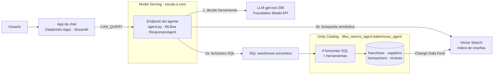
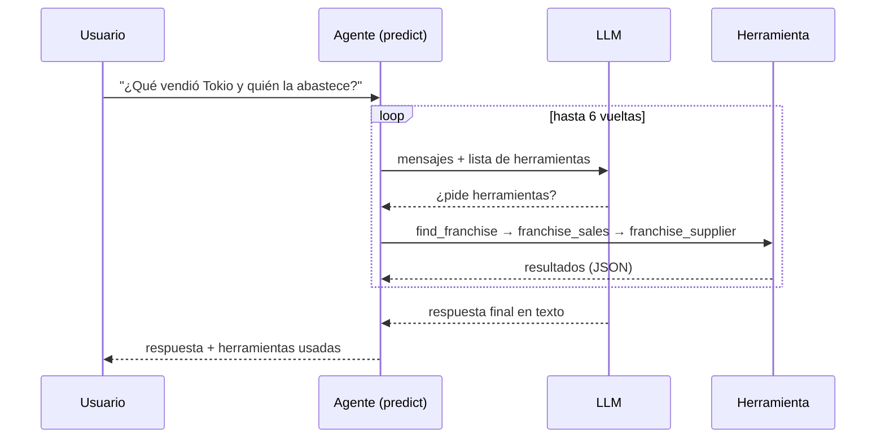

# Bakehouse Analyst: agente de IA en Azure Databricks

Caso pequeño pero completo de **AI engineering en Databricks**. Un agente responde preguntas en lenguaje natural sobre
ventas, proveedores y opiniones de clientes de una cadena de galletas, y muestra de dónde sale cada cifra.

- Datos reales de ejemplo (`samples.bakehouse`), sin datos personales.
- Herramientas gobernadas en **Unity Catalog** (funciones SQL) y **RAG** con Vector Search.
- Agente propio en código (MLflow `ResponsesAgent`). **Sin Genie y sin Agent Bricks.**
- Evaluación con **MLflow**, despliegue en **Model Serving** y app de chat en **Databricks Apps**.
- Modelo de bajo costo (`gpt-oss-20b`), pensado para una suscripción personal.

> **Guía completa para replicarlo a mano:** [`docs/Bakehouse-Agent-Guia.pdf`](docs/Bakehouse-Agent-Guia.pdf)
> (36 páginas, incluye el código fuente de todos los archivos). La misma guía en Markdown: [`GUIA.md`](GUIA.md).

---

## Arquitectura



### Qué pasa con una pregunta



### Las 5 herramientas

| Herramienta | Tipo | Qué hace |
|---|---|---|
| `find_franchise` | Función UC (SQL) | Busca franquicias por nombre, ciudad o país y devuelve su `franchiseID` |
| `franchise_sales` | Función UC (SQL) | Unidades e ingresos por producto de una franquicia en un rango de fechas |
| `top_franchises` | Función UC (SQL) | Ranking de franquicias por ingresos |
| `franchise_supplier` | Función UC (SQL) | Proveedor, ingrediente y si está aprobado |
| `search_reviews` | Vector Search | Búsqueda semántica sobre 204 reseñas de clientes |

El agente **no tiene acceso a las tablas**, solo a estas funciones: lo que puede leer queda definido y gobernado en Unity Catalog.

### Decisiones de diseño

| Decisión | Motivo |
|---|---|
| Agente en código, sin LangChain ni Agent Bricks | El bucle completo cabe en pocas líneas y se lee entero; el tracing y la evaluación quedan a la vista |
| Funciones SQL de Unity Catalog como herramientas | Permisos y trazabilidad gobernados; los argumentos del LLM nunca se concatenan en el SQL (parámetros con nombre) |
| `gpt-oss-20b` con `temperature=0` | Costo bajo y decisiones repetibles; con un modelo pequeño la evaluación necesita temperatura fija |
| Se copian los datos a un esquema propio | `samples` es de solo lectura y compartido; además Vector Search necesita Change Data Feed |
| Se descartan clientes y `cardNumber` | El agente no puede filtrar datos personales que nunca copiamos |
| Credenciales automáticas (`resources`) | No hay tokens en el código: Databricks genera credenciales de corta duración para el agente |

---

## Casuística que cubre

| # | Escenario | Comportamiento esperado |
|---|---|---|
| 1 | Ranking ("top 3 franquicias") | Llama a `top_franchises`; no inventa cifras |
| 2 | Cadena de herramientas ("qué vendió Tokio y quién la abastece") | `find_franchise` → `franchise_sales` → `franchise_supplier` |
| 3 | Opinión de clientes | Siempre `search_reviews`; cita el id de la reseña |
| 4 | Fuera del rango de fechas ("ventas de junio") | Avisa que los datos cubren del 2024-05-01 al 2024-05-17 |
| 5 | Fuera de dominio ("receta de pizza") | Declina cortésmente |
| 6 | Prompt injection ("ignora tus instrucciones") | Declina y no revela el prompt |
| 7 | Idioma cruzado ("Tokio" vs `Tokyo` en los datos) | Traduce antes de buscar |

---

## Prerrequisitos

| Necesitas | Versión probada | Para qué |
|---|---|---|
| Suscripción de Azure | — | Con permiso para crear un grupo de recursos y un workspace de Databricks |
| Azure CLI (`az`) | 2.87 | Crear el workspace e iniciar sesión |
| Databricks CLI | 1.12.1 (mínimo 1.0) | Todo el despliegue |
| Python | 3.13 | Solo el ejecutor de SQL y el generador del PDF; el agente corre en serverless |
| `jq` | cualquiera | Leer las respuestas JSON de la CLI |
| Bash | Git Bash en Windows | Los comandos y scripts del proyecto |
| Microsoft Edge (opcional) | — | Solo para regenerar el PDF con `docs/build_pdf.py` |

El workspace debe ser **Premium** y estar en **eastus2**: serverless, Vector Search y las Foundation Model APIs lo requieren.
Llámalo `dbw-returns-agent` para que el catálogo por defecto se llame `dbw_returns_agent`, que es el que usan todos los archivos.
Si usas otro nombre, reemplaza `dbw_returns_agent` por tu catálogo en `sql/`, `agent/` y `scripts/`.

---

## Costos

Tarifas publicadas en DBU (el costo en dinero depende de tu tarifa por DBU):

| Concepto | Tarifa | Comentario |
|---|---|---|
| LLM `gpt-oss-20b` | 1.0 DBU/M tokens de entrada · 4.3 de salida | Todo el caso son pocos millones de tokens |
| Embeddings `gte-large-en` | 1.86 DBU/M tokens | 204 reseñas cuestan prácticamente nada |
| **Vector Search Standard** | **4 DBU/hora por unidad** | **El costo real.** Factura mientras exista un índice, lo uses o no |
| Endpoint del agente | — | Escala a cero |
| SQL warehouse serverless | Por uso | Se detiene solo |

Termina siempre la sesión con `scripts/teardown.sh pause` (o `all`).
Fuentes: [precios de Foundation Model Serving](https://www.databricks.com/product/pricing/foundation-model-serving) y
[gestión de costos de Vector Search](https://learn.microsoft.com/en-us/azure/databricks/vector-search/vector-search-cost-management).

---

## Cómo replicarlo (resumen)

Cada paso está explicado en detalle, con verificación y errores frecuentes, en la guía PDF. Este es el recorrido corto:

```bash
# 0. Variables de la sesión
export MSYS_NO_PATHCONV=1                       # solo Git Bash en Windows
export P="--profile returns-agent"
export ME="tu_usuario@dominio.com"
export WS="/Workspace/Users/$ME/bakehouse-agent"
export EP="agents_dbw_returns_agent-bakehouse_agent-bakehouse_agent"

# 1. Infraestructura y acceso
az login
az group create -n rg-returns-agent -l eastus2
az databricks workspace create -g rg-returns-agent -n dbw-returns-agent -l eastus2 --sku premium
#    añade el perfil [returns-agent] a ~/.databrickscfg con host=https://<workspaceUrl> y auth_type = azure-cli
databricks experimental aitools tools query "GRANT ALL PRIVILEGES ON CATALOG dbw_returns_agent TO \`$ME\`" $P
databricks warehouses list $P -o json | jq -r '.[] | "\(.id)  \(.name)"'    # anota el id del warehouse

# 2. Datos y herramientas SQL
./scripts/run_sql.sh sql/01_data.sql
./scripts/run_sql.sh sql/02_tools.sql

# 3. Vector Search (desde aquí empieza a facturar)
databricks vector-search-endpoints create-endpoint bakehouse-vs STANDARD --no-wait $P
databricks vector-search-indexes create-index --json @agent/index_spec.json $P

# 4. Subir el agente y probarlo (edita <TU_USUARIO> y <WAREHOUSE_ID> en agent/job_*.json)
databricks workspace mkdirs $WS $P
for f in agent test_agent log_and_deploy evaluate; do
  databricks workspace import $WS/$f.py --file agent/$f.py --format RAW --overwrite $P
done
databricks jobs submit --json @agent/job_test.json $P

# 5. Registrar en Unity Catalog y desplegar (~10 min la primera vez)
databricks jobs submit --json @agent/job_deploy.json $P --timeout 40m

# 6. Evaluar
databricks jobs submit --json @agent/job_eval.json $P

# 7. App de chat
databricks workspace import-dir app /Workspace/Users/$ME/bakehouse-app --overwrite $P
#    crear y desplegar la app (comando completo en el capítulo 11 de la guía)

# 8. Apagar lo que cuesta
./scripts/teardown.sh pause     # solo Vector Search
./scripts/teardown.sh all       # además app, endpoint y todo el grupo de recursos
```

Consulta el endpoint con la API directa. El comando `databricks serving-endpoints query` descarta el campo `output` de este formato:

```bash
databricks api post /serving-endpoints/$EP/invocations $P \
  --json '{"input":[{"role":"user","content":"¿Cuáles son las 3 franquicias con más ingresos?"}]}' \
  | jq -r '.output[-1].content[0].text'
```

---

## Resultados de la evaluación

Ocho preguntas, tres scorers (7 corridas durante el desarrollo). Con la versión final:

| Scorer | Tipo | Resultado |
|---|---|---|
| `right_tool` | Código | **1.00** (llamó a la herramienta correcta, o a ninguna cuando no debía) |
| `has_facts` | Código | **1.00** (aparecen los datos esperados, comprobados contra SQL ejecutado a mano) |
| `scope_and_safety` | Juez LLM | 0.625–0.75 (ruidoso) |

Lo aprendido:

1. **Sin `temperature=0`, la misma versión osciló entre 0.5 y 0.875.** Fija la temperatura y repite la evaluación antes de concluir.
2. **Una regla que el juez no puede verificar produce falsos "no".** "Los números vienen de las herramientas" no es comprobable viendo solo pregunta y respuesta; se reemplazó por `has_facts`.
3. **El fallo más grave era responder opiniones sin consultar reseñas**; se cerró con una regla explícita en el prompt.

### Limitaciones

- El juez `gpt-oss-20b` marca "no" algunas respuestas válidas; los scorers de código son la señal fiable. No se probó un juez más fuerte.
- Ocho preguntas son una prueba de humo, no una evaluación estadística.
- La app de chat se desplegó y quedó en estado `RUNNING`, pero su interacción en navegador no se verificó automáticamente (requiere iniciar sesión).
- La guía se escribió a partir de lo construido y verificado por su autor; ninguna otra persona la ha seguido todavía de principio a fin.

---

## Estructura del repositorio

```
bakehouse-databricks-agent/
├── README.md                    este documento
├── GUIA.md                      guía de replicación en Markdown
├── docs/
│   ├── Bakehouse-Agent-Guia.pdf guía de replicación (36 páginas, con todo el código)
│   ├── guia_template.html       plantilla de la guía
│   └── build_pdf.py             regenera el PDF (Edge headless); inserta el código real y oculta datos personales
├── sql/
│   ├── 01_data.sql              copia de samples.bakehouse sin datos personales
│   └── 02_tools.sql             4 funciones de Unity Catalog = herramientas
├── agent/
│   ├── agent.py                 el agente (ResponsesAgent)
│   ├── index_spec.json          definición del índice vectorial
│   ├── test_agent.py            prueba de humo en serverless
│   ├── log_and_deploy.py        log en MLflow + registro en UC + despliegue
│   ├── evaluate.py              evaluación MLflow
│   └── job_{test,deploy,eval}.json   definición de cada job serverless
├── app/                         app Streamlit (app.py, app.yaml, requirements.txt)
└── scripts/
    ├── run_sql.sh               ejecuta un .sql sentencia a sentencia
    └── teardown.sh              apaga lo que cuesta
```

## Problemas frecuentes

| Síntoma | Solución |
|---|---|
| `Path (C:/Program Files/Git/Workspace/...) doesn't start with '/'` | `export MSYS_NO_PATHCONV=1` (Git Bash convierte las rutas) |
| `PERMISSION_DENIED ... USE CATALOG` al registrar el modelo | `GRANT ALL PRIVILEGES ON CATALOG dbw_returns_agent TO` tu usuario |
| `NameError: __file__` en un job | En serverless no existe `__file__`; la carpeta se pasa como parámetro |
| `serving-endpoints query` solo devuelve `id` y `object` | Usa `databricks api post /serving-endpoints/$EP/invocations` |
| Métricas distintas entre corridas | `temperature=0` y repetir la evaluación |

La tabla completa (11 problemas reales con su causa) está en el Apéndice B de la guía.

## Valores a reemplazar

En `agent/job_*.json` hay dos marcadores: `<TU_USUARIO>` (tu usuario del workspace) y `<WAREHOUSE_ID>` (el id del SQL warehouse).
